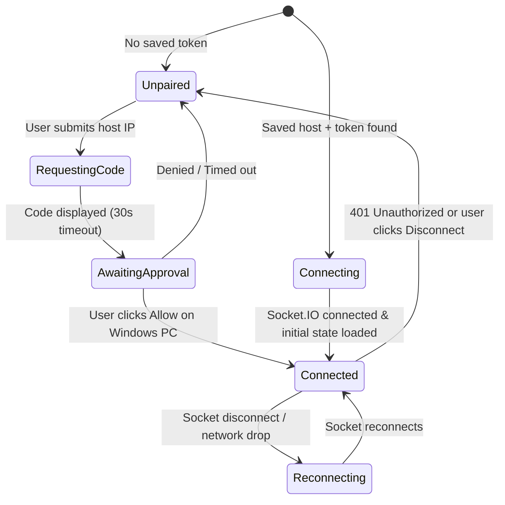

# Phase 1 Data Model: Tubify Client & Companion Entities

## 1. Client Persistence Model (`localStorage`)

### `ConnectionProfile`
Stored under key `tubify.connection.v1`.

| Field | Type | Validation / Rules | Description |
|---|---|---|---|
| `host` | `string` | Non-empty IPv4 or hostname (defaults to `window.location.hostname` if not `localhost`, else `192.168.0.144`) | Target Windows PC LAN IP or Tailscale IP |
| `port` | `number` | Integer `1..65535`, default `9863` | YTMDesktop Companion Server port |
| `appId` | `string` | Lowercase alphanumeric `2..32` chars, default `"tubify"` | Identifier bound to the YTMDesktop token |
| `token` | `string \| null` | Non-empty token string once paired | Token returned by `POST /api/v1/auth/request` |

## 2. Upstream YTMDesktop v2 State Entities (`src/types/companion.ts`)

### `CompanionState` (Payload of `GET /api/v1/state` and Socket.IO `state-update`)

```ts
export type TrackState = -1 | 0 | 1 | 2; // -1 Unknown, 0 Paused, 1 Playing, 2 Buffering
export type RepeatMode = -1 | 0 | 1 | 2; // -1 Unknown, 0 None, 1 All, 2 One
export type LikeStatus = -1 | 0 | 1 | 2; // -1 Unknown, 0 Dislike, 1 Indifferent, 2 Like

export interface Thumbnail {
  url: string;
  width: number;
  height: number;
}

export interface QueueItem {
  thumbnails: Thumbnail[];
  title: string;
  author: string;
  duration: string;
  selected: boolean;
  videoId: string;
  counterparts?: QueueItem[] | null;
}

export interface PlayerQueue {
  autoplay: boolean;
  items: QueueItem[];
  automixItems: QueueItem[];
  isGenerating: boolean;
  isInfinite: boolean;
  repeatMode: RepeatMode;
  selectedItemIndex: number;
}

export interface VideoMetadata {
  author: string;
  channelId: string;
  title: string;
  album: string | null;
  albumId: string | null;
  likeStatus: LikeStatus | null;
  thumbnails: Thumbnail[];
  durationSeconds: number;
  id: string;
  isLive?: boolean;
  videoType?: -1 | 0 | 1 | 2 | 3;
  metadataFilled?: boolean;
}

export interface CompanionState {
  player: {
    trackState: TrackState;
    videoProgress: number; // Seconds (float/number)
    volume: number;        // 0..100
    adPlaying: boolean;
    queue: PlayerQueue | null;
  };
  video: VideoMetadata | null;
  playlistId: string | null;
}

export interface PlaylistSummary {
  id: string;
  title: string;
}
```

## 3. Connection Lifecycle States


