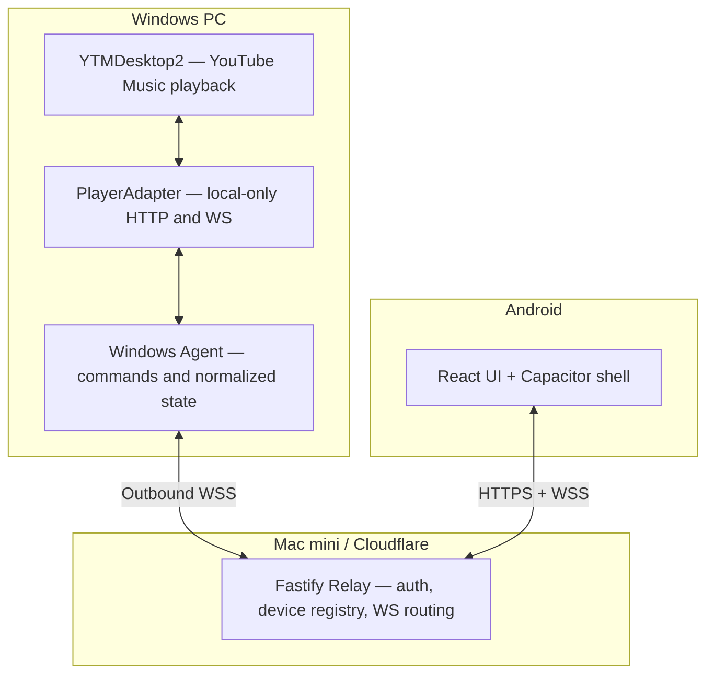

# YouTube Music Connect — Architecture & Implementation Specification

**Status:** Proposed design / not yet implemented  
**Baseline:** October 24, 2026  
**Primary goal:** Use an Android device to remotely control YouTube Music playing in a Windows desktop application, including real-time state and queue management; provide a path to Internet access and multiple devices.

## 0. Product decisions

- **Windows remains the playback device.** Music streams only in an independently installed YouTube Music desktop player. The phone is a controller, not a proxy audio streamer.
- **Primary player:** YTMDesktop2 (tested against its *documented interface*, not tested live on the user's computer). Its default local HTTP API is `http://127.0.0.1:13091`, including WebSocket `/socket` and queue navigation APIs.
- **Optional adapter:** YTMDesktop v2, whose Companion Server is `http://127.0.0.1:9863/api/v1` and uses Socket.IO at `/api/v1/realtime`. It supports fewer queue operations in its documented public API.
- **One TypeScript monorepo:** Node.js bridge, React mobile web UI, optional Capacitor Android wrapper, and Fastify relay.
- **Initial feature target:** choose Windows device; observe now playing; play/pause; next/previous; seek; set player volume; display queue; play specific YouTube video ID; append song to queue (YTMDesktop2 only); reconnect and recover state.
- **Do not initially promise:** full official YouTube Music search, official Android app integration, mobile audio transfer, synchronized queues across native YouTube Music sessions, offline playback, or bypassing YouTube restrictions.
- **Progressive deployment:** Stage A: localhost bridge with a simulated client; Stage B: authenticated mobile access using HTTPS/WSS relay; Stage C: native Android packaging and extra device capabilities. If direct LAN support is added later, use a deliberately secured transport rather than silently exposing the desktop API.

## 1. System context and data flow



### Responsibilities

**Player adapter (Windows):** Authenticates with YTMDesktop2, listens on its WebSocket, normalizes source-specific schemas, converts standardized commands into YTMDesktop2 endpoints. Its desktop-player bearer token never leaves Windows.

**Windows agent:** Maintains a stable `deviceId`, connection status, state revision, capabilities, command execution queue and deduplication window. Publishes state snapshots when the player changes and after reconnects. Optionally provides a system tray pairing/approval UI. Stores secrets in Windows DPAPI or an OS credential vault; never commits tokens to source.

**Relay (Mac mini):** Authenticates device and mobile connections, routes commands to the appropriate connected device, provides device discovery and pairing, forwards normalized state. It does **not** fetch YouTube Music, handle Google login, store audio or music files, or receive YTMDesktop2's local API token. For MVP, single-user and in-memory session/last-state storage are sufficient; use SQLite only for durable pairing/device credentials.

**Mobile:** Shows currently active player and selected-device controls; renders received authoritative state; derives smooth progress display locally between timestamps; submits commands with request IDs; handles reconnect and error states. Android native integrations can be layered on later.

**Networking:** Cloudflare Tunnel fronts the Mac mini relay; Windows makes an outbound WSS connection, so no Windows inbound firewall port-forward is needed for Internet mode. Cloudflare Tunnel supports WebSockets. Put authorization at the application layer; optional Cloudflare Access is defense-in-depth, not a replacement for per-device permission checks.

## 2. Suggested stack

| Layer | Choice | Notes |
|---|---|---|
| Monorepo | pnpm workspaces + Turborepo (optional) | TypeScript types shared everywhere |
| Windows bridge | Node.js LTS + TypeScript | Headless process; tray UI optional |
| HTTP / Relay | Fastify | Validation and WebSocket endpoints |
| Realtime | Native WebSocket / `ws` | Distinct from upstream YTMDesktop2 WS |
| Player client | native `fetch` + `ws` | `Authorization: Bearer <token>` for HTTP |
| UI | React, Vite, TanStack Query | Query for initial snapshots, WS for updates |
| Client state | Zustand or React context | Avoid two sources of truth |
| Android | Capacitor | Reuse web UI; add secure token storage plugin |
| Schemas | Zod | Runtime validation and TypeScript inference |
| Persistence | SQLite | Pairing tokens hashed at rest; stable devices |
| Tests | Vitest; Playwright; Android smoke test | Mock player adapter before integration |
| Logs | Pino | Redact credentials; structured events |

## 3. Repository structure

```text
ytm-connect/
├── apps/
│   ├── mobile/                   # Vite/React UI + Capacitor Android
│   │   ├── src/
│   │   │   ├── screens/          # Devices, NowPlaying, Queue, Pairing
│   │   │   ├── components/
│   │   │   ├── api/              # Typed HTTP and WS client
│   │   │   ├── stores/           # UI selection, status, normalized state
│   │   │   └── hooks/
│   │   ├── android/              # Added by Capacitor when initialized
│   │   └── capacitor.config.ts
│   ├── windows-agent/           # Service / tray controller, no music UI
│   │   └── src/
│   │       ├── index.ts
│   │       ├── agent.ts
│   │       ├── pairing.ts
│   │       ├── reconnect.ts
│   │       └── providers/
│   │           ├── player-adapter.ts
│   │           ├── ytmdesktop2.ts
│   │           └── ytmdesktop-v2.ts  # Future fallback
│   └── relay/                   # Fastify app on Mac mini
│       └── src/
│           ├── server.ts
│           ├── auth/
│           ├── routes/
│           ├── ws/
│           ├── registry/
│           └── storage/
├── packages/
│   ├── protocol/                # Zod DTOs, events, commands, version
│   ├── player-core/             # Device state and adapter abstractions
│   ├── api-client/              # Reusable relay API client
│   └── ui/                      # Optional common React components
├── tests/
│   ├── fixtures/                # Sample provider states / mock player
│   ├── integration/
│   └── e2e/
├── docs/
│   ├── architecture.md
│   ├── api.md
│   ├── security.md
│   └── player-compatibility.md
├── infra/
│   ├── docker-compose.yml       # Relay only
│   └── cloudflare-tunnel.md
├── .env.example
├── pnpm-workspace.yaml
├── package.json
└── README.md
```

## 4. Upstream player integration

### YTMDesktop2 — initial target

- Player HTTP base: `http://127.0.0.1:13091` (unless user changes port).
- `POST /auth/requestcode`, then `POST /auth/request`: pairing and approval in player; persist resulting token on Windows only.
- `GET /track` and `GET /track/state`: track and current playback state.
- `GET /nav/queue`: queue snapshot (may be incomplete before the player's YTM store hook initializes).
- `POST /track/play`, `/track/pause`, `/track/next`, `/track/prev`, `/track/seek` with `{ "time": seconds }`, `/track/volume` with `{ "volume": 0..100 }`.
- `POST /nav/watch` with `{ "videoId": "..." }` to start playback.
- `POST /nav/queue` with `{ "videoId": "..." }` to append to queue (requires active queue context).
- `POST /nav/queue/clear` clears upcoming queue.
- WebSocket `/socket`: event frames include `track:change` and `track:state`, with payload inside `data` arrays.
- Some provider API operations can be unavailable while the desktop player is loading; treat `503` as temporarily unavailable.

### YTMDesktop v2 — later adapter

- Local HTTP base `http://127.0.0.1:9863/api/v1`.
- `GET /metadata` at `http://127.0.0.1:9863/metadata` can detect installation.
- `POST /auth/requestcode`, `POST /auth/request`: bearer-less `Authorization` value according to YTMDesktop v2 docs.
- `GET /state`, `GET /playlists`, `POST /command` with `command` names `play`, `pause`, `next`, `previous`, `seekTo`, `setVolume`, `changeVideo`, etc.
- Socket.IO at `/api/v1/realtime`, `{ transports: ['websocket'], auth: { token } }`, use `127.0.0.1` rather than relying on `localhost` resolving to IPv4.
- Queue append/clear are not documented; advertise `queueAdd: false` / `queueClear: false` rather than implementing unreliable hacks.

### Provider adapter interface

```ts
export interface PlayerAdapter {
  id: 'ytmdesktop2' | 'ytmdesktop-v2';
  connect(): Promise<void>;
  disconnect(): Promise<void>;
  getState(): Promise<PlayerState>;
  subscribe(onState: (state: PlayerState) => void): () => void;
  execute(command: PlayerCommand): Promise<void>;
  capabilities(): PlayerCapabilities;
}
```

Do not expose source-specific data objects to the Android UI. Add explicit compatibility tests for different desktop player releases.

## 5. Shared normalized models

Use Zod to validate all command payloads, all network messages and upstream mappings. Recommended DTOs:

```ts
type Device = {
  id: string;
  name: string;              // e.g. 'Gaming PC'
  platform: 'windows';
  online: boolean;
  capabilities: PlayerCapabilities;
  lastSeenAt: string;        // ISO-8601 UTC
};

type PlayerCapabilities = {
  playById: boolean;
  seek: boolean;
  volume: boolean;
  queueRead: boolean;
  queueAdd: boolean;
  queueClear: boolean;
  search: boolean;
};

type PlayerState = {
  deviceId: string;
  revision: number;          // Monotonically increasing per agent session
  sessionId: string;         // Changes when agent restarts
  capturedAt: string;        // UTC instant of actual observation
  status: 'playing' | 'paused' | 'buffering' | 'idle' | 'offline';
  track: null | {
    videoId: string;
    title: string;
    artists: string[];
    album?: string;
    artworkUrl?: string;
    durationMs: number;
  };
  positionMs: number;
  volumePercent: number | null;
  repeat: 'off' | 'one' | 'all' | 'unknown';
  shuffle: boolean | null;
  queue: Array<{
    videoId: string;
    title: string;
    artists: string[];
    artworkUrl?: string;
  }>;
};
```

Rules: (1) position is milliseconds in our protocol even though provider endpoints often take seconds; (2) clock timestamps use ISO UTC; (3) authoritatively reported state only—do not assume a command succeeded merely because it was accepted; (4) advertise unsupported features; (5) model `offline`, `no player`, and `buffering` separately; (6) do not emit duplicate updates when state is unchanged.

## 6. Public relay API — proposed contract (not YTMDesktop2's upstream API)

All following routes are *our* routes, prefixed `/api/v1`. They do not exist yet.

| Method | Route | Purpose |
|---|---|---|
| GET | `/health` | Liveness check; no private device metadata |
| POST | `/api/v1/pairing/claims` | Claim time-limited QR / pairing code |
| GET | `/api/v1/pairing/claims/:claimId` | Poll pending/approved/denied state |
| POST | `/api/v1/pairing/claims/:claimId/approve` | Authenticated Windows agent approves |
| POST | `/api/v1/auth/refresh` | Rotate mobile credential |
| POST | `/api/v1/auth/revoke` | Revoke mobile access |
| GET | `/api/v1/devices` | Paired device list and capabilities |
| GET | `/api/v1/devices/:deviceId/state` | Initial normalized state snapshot |
| GET | `/api/v1/devices/:deviceId/queue` | Read queue if supported |
| POST | `/api/v1/devices/:deviceId/commands` | Execute action on selected Windows PC |
| GET | `/api/v1/search?q=...` | Future optional search provider, not MVP |
| WS | `/api/v1/events` | Authenticated events and command receipts |
| WS | `/api/v1/agent` | Authenticated Windows agent outbound link |

### Command request

```json
{
  "requestId": "4e2df241-81ee-4e3d-94a9-0c91ee49514e",
  "action": "seek",
  "params": { "positionMs": 91300 }
}
```

Supported `action` values for the first complete vertical slice:

- `play`, `pause`, `next`, `previous`: empty params.
- `seek`: `{ "positionMs": number }`, 0 to track duration.
- `setVolume`: `{ "volumePercent": number }`, 0 to 100.
- `playTrack`: `{ "videoId": string }` (optional playlist context later).
- `enqueue`: `{ "videoId": string }`, only when `queueAdd` capability is true.
- `clearQueue`: empty params, only when `queueClear` capability is true.

Return `202 Accepted` with `{ "requestId": "...", "status": "queued" }` when dispatched to an online agent, or `409` for offline / `422` for unsupported commands. **Queued does not mean successfully applied.** Agent publishes a separate result event (success/error) after calling the desktop API; clients then await authoritative state.

### Event envelope

```json
{
  "version": 1,
  "type": "player.state",
  "deviceId": "windows-gamingpc-01",
  "seq": 1042,
  "sentAt": "2026-10-24T11:00:00.000Z",
  "payload": { "sessionId": "...", "revision": 28, "status": "playing" }
}
```

Other events: `device.online`, `device.offline`, `player.state`, `queue.changed`, `command.result`, `pairing.requested`, `pairing.approved`, `pairing.denied`.

The server sends a full state snapshot after connection/reconnection, then live updates. Client ignores out-of-order state revisions in the same agent session, refreshes on `sessionId` changes, and uses `requestId` for idempotency. Relay retains only latest state per device; history is optional and not required for MVP.

## 7. Timing, reliability, and UX

- Provider WebSocket events are the source of truth; throttle outgoing progress updates to approximately 1–2 seconds while playing, immediately publish track/status/queue changes. Keep this configurable.
- Locally interpolate progress between updates while `status === 'playing'`; reconcile on the next observed player state.
- Serialize potentially conflicting playback commands per device, reject invalid ranges and deduplicate retried `requestId`s for a short TTL.
- WebSocket heartbeats around every 20 seconds; mark offline after missed heartbeat threshold (e.g., 60 seconds); reconnect with bounded exponential backoff and jitter.
- UI maintains selected device and displays its online/paired/offline status. A reconnect never automatically starts music.
- Show spinner and confirmation/error when a command is dispatched; never permanently flip state only because a request was accepted.
- Queue addition may require an active playback context; show an actionable error when not available.

## 8. Pairing and security

1. A Windows agent has a stable secret/device key provisioned for this single-user relay; on first run, it establishes an authenticated outbound WebSocket to the relay. Reject unauthenticated agent registration on a public host.
2. The Windows agent generates a cryptographically random, single-use pairing challenge valid for ~90 seconds and displays a QR containing relay address, claim ID and short-lived secret. The relay stores a one-way verifier and expiry.
3. Android claims the pairing request. The Windows app shows the requesting device and requires explicit user approval.
4. On approval, issue a device-scoped mobile credential, store only hashes server-side and use Android Keystore-backed storage on the phone.
5. Supports revocation of individual phones and rate-limiting failed claims. Expire/revoke abandoned pairing attempts.
6. Bind the YTMDesktop2 API to loopback; never forward port `13091` or its bearer token to the Internet. Relay credentials and Google session data remain separate.
7. Use HTTPS/WSS through Cloudflare; authenticate REST requests and WS sessions; for browser WS use short-lived upgrade tickets instead of long-lived secrets in URL strings. Check origin as an additional defense for browser clients.
8. Scope all device queries and commands to the authenticated owner; never trust client-provided `deviceId` alone.
9. For direct LAN mode, don't silently rely on cleartext HTTP with persistent bearer tokens; add LAN transport deliberately, using HTTPS with a verified certificate or an encrypted overlay such as Tailscale.
10. Keep secrets out of logs and `.env.example` values; support token rotation and server-side invalidation.

### Cloudflare deployment

- Existing Mac mini runs relay on `127.0.0.1:<relay-port>` in a container (or native Node service).
- Add Cloudflare Tunnel hostname, e.g. `connect.YOUR_DOMAIN`, pointing to relay HTTP port; HTTPS terminates at Cloudflare, WebSocket upgrades are forwarded.
- Windows Agent is an outbound WSS client to `wss://connect.YOUR_DOMAIN/api/v1/agent`.
- Android connects to `https://connect.YOUR_DOMAIN/api/v1/...` and `/api/v1/events`.
- This relay handles only metadata, commands and authentication, so traffic should be small; it does not relay music streaming.

## 9. Search / library phase (not initial MVP)

Neither of the two reviewed desktop control APIs offers an official general search endpoint. Keep `SearchProvider` separate from `PlayerAdapter`:

```ts
interface SearchProvider {
  search(query: string, filter?: 'songs' | 'albums' | 'artists'): Promise<SearchResult[]>;
}
```

Candidates:

1. **Official YouTube Data API**: stable published interface, but its YouTube-oriented results do not precisely replicate YouTube Music search/library/recommendations; default quota may limit heavy typing-as-you-search usage. Debounce and cache if chosen.
2. **`ytmusicapi`**: unofficial reverse-engineered YouTube Music endpoints; supports unauthenticated search and optional authenticated library actions. Fragile when Google changes its internals. If used, run an isolated, optional service with conservative request limits; never send Google cookies through the relay or mobile client.
3. **Search within YTMDesktop itself**: leave the official-looking music browsing interface on Windows, and use paste/share-link-to-play or explicit video IDs remotely in the first release.

Search results should produce `videoId` / `playlistId` that the player adapter can open or queue. Distinguish *queued track control* from *library management*, which requires additional APIs and credentials.

## 10. Android-specific notes

- Implement mobile layout as a React app first; package with Capacitor into an Android APK after core remote behavior works.
- Store pairing credential in Android Keystore-backed secure storage, not unencrypted localStorage. Reconnect on app foreground.
- True lock-screen controls and a persistent media notification require native Android integration (MediaSession / foreground-service design) and are deliberately outside MVP.
- A PWA served over a plain HTTP LAN IP is not generally installable, as service workers/PWA installation require a secure context. Cloudflare HTTPS is adequate for the web client, and Capacitor provides the native-app packaging path.
- Do not claim the phone itself is playing music: volume and transport controls target the selected Windows player.

## 11. Initial milestones and acceptance criteria

### M0 — Desktop API spike (first priority)

- Install YTMDesktop2 and sign in to YouTube Music.
- Enable API and require authorization in YTMDesktop2 settings.
- Request/approve a client token, read `/track` and `/track/state`, run `play`/`pause`/`next`, subscribe to `/socket` events.
- Verify `POST /nav/watch` and `/nav/queue` while a track is active. Note actual behavior on your version, especially queue hook readiness.
- Document unsupported commands and any API regressions.

**Done when:** A Windows local TypeScript CLI can play/pause/seek and print live state changes without polling. No mobile work until this passes.

### M1 — Player adapter and Windows agent

- Create `packages/protocol` DTOs/Zod schemas and `PlayerAdapter` interface.
- Implement YTMDesktop2 adapter, local credential storage, event normalization, state revisions and deduplication.
- Build a mock player adapter and integration tests; implement error recovery when player restarts.
- Provide CLI agent status and a simple pairing approval mechanism before building a tray UI.

**Done when:** Mock and live player modes pass commands through the same interface, and reconnect produces an accurate state snapshot.

### M2 — Relay and authenticated pairing

- Build Fastify REST and WS protocol endpoints, device registry, relay routing and agent outbound connection.
- Add expiring one-time pairing and desktop approval, revocation, scoped tokens and rate limits.
- Deploy only relay to Mac mini using Cloudflare Tunnel; keep YTMDesktop2 bound locally on Windows.
- Validate offline/online behavior over Wi-Fi and mobile data.

**Done when:** An authenticated REST/WS client can remotely select the PC and control it over the Internet; an unpaired client cannot read state or issue commands.

### M3 — React mobile UI

- Build pairing, devices list, now-playing, progress/seek, artwork, volume, shuffle/repeat when capabilities exist, and queue screens.
- Display command acknowledgments, offline state and reconnect behavior.
- Convert to installable Android APK using Capacitor; persist credentials securely.
- Test Android phone Wi-Fi and mobile data.

**Done when:** A real Android phone can select the PC, play/pause/skip/seek/set volume, and observe track and progress changes reliably with PC playback continuing when phone UI closes.

### M4 — Search and quality-of-life

- Add optional search provider behind interface; cache/debounce requests; verify music-specific result quality.
- Search to play-by-ID and add-to-queue actions.
- Implement device aliases, background auto-start, Windows tray integration, disconnect/reconnect prompts and optional Android media controls.
- Add a second Windows device and failover/device selection UX.

**Done when:** Search or paste a shared song link on Android and play/queue it on a chosen PC without modifying music playback internals.

### M5 — Later / experimental

- Optional local encrypted LAN transport.
- Best-effort track-and-position handoff between two compatible desktop agents; do not promise identical queue continuation.
- Playlist/library management only if a stable search/library provider is acceptable.
- Native Android lock-screen controls after assessing Android OS background constraints.

## 12. Testing matrix

- Player open, playing, paused, buffering, idle, ad-playing and unexpectedly closed.
- Android on same Wi-Fi; Android on mobile data; phone switching networks while a track plays.
- Relay restarts while Windows continues music; agent restarts while relay and Android remain connected.
- Two phones send conflicting commands (command order and idempotency).
- Expired pairing code, revoked token, malicious unmatched device ID, unsupported queue actions.
- Seek past duration, volume outside 0..100, empty queue, invalid video ID, player loading/503.
- Browser and Android package reconnect/foreground behavior.
- Two Windows agents on the same relay, independent state and device selection.

## 13. Immediate proof-of-concept (PowerShell)

After installing and enabling the API in YTMDesktop2:

```powershell
$base = 'http://127.0.0.1:13091'
Invoke-RestMethod "$base/"  # API discovery

$pair = Invoke-RestMethod "$base/auth/requestcode" -Method Post -ContentType 'application/json' -Body '{"appId":"ytmconnectagent","appName":"YTM Connect Agent","appVersion":"0.1.0"}'
$body = @{appId='ytmconnectagent';code=$pair.code} | ConvertTo-Json
# Approve the request in YTMDesktop2's Authentication settings while this executes.
$authorized = Invoke-RestMethod "$base/auth/request" -Method Post -ContentType 'application/json' -Body $body
$headers = @{ Authorization = "Bearer $($authorized.token)" }
Invoke-RestMethod "$base/track" -Headers $headers
Invoke-RestMethod "$base/track/state" -Headers $headers
Invoke-RestMethod "$base/track/next" -Method Post -Headers $headers
```

The pairing request is expected to wait for user approval; do not print or share `$authorized.token`.

## 14. Engineering guardrails for Codex

1. Implement M0 and M1 first. Do not fabricate endpoints not present in linked upstream player documentation.
2. Add source-specific adapters behind `PlayerAdapter` and document each capability.
3. Keep media streaming, cookies, and Google authentication entirely outside the relay.
4. Use shared Zod contracts and unit tests for protocol messages; always translate seconds↔milliseconds deliberately.
5. All incoming actions must be authorized, validated, rate-limited and scoped to a paired device.
6. The UI consumes authoritative events, not guessed command outcomes.
7. Favor a vertical slice (one connected player, one selected device, now-playing and play/pause) over building every screen before networking works.
8. Never expose a desktop player's local REST API or token via Cloudflare Tunnel.
9. Provide reproducible development scripts, test fixtures and concise setup documentation.
10. Label feature gaps explicitly and do not silently use unofficial YouTube Music endpoints without an opt-in.

## 15. Reference documentation (verified 2026-10-24)

- YTMDesktop2 main site: https://youtube-music.app/
- YTMDesktop2 local API setup: https://youtube-music.app/docs/api/
- YTMDesktop2 routes and WebSocket protocol: https://youtube-music.app/docs/api/routes/
- YTMDesktop2 authentication: https://youtube-music.app/docs/api/authentication/
- YTMDesktop v2 Companion Server API: https://github.com/ytmdesktop/ytmdesktop/wiki/v2-%E2%80%90-Companion-Server-API-v1
- ytmusicapi project: https://github.com/sigma67/ytmusicapi
- Cloudflare Tunnel WebSockets: https://developers.cloudflare.com/cloudflare-one/faq/cloudflare-tunnels-faq/
- MDN PWA installability/security: https://developer.mozilla.org/en-US/docs/Web/Progressive_web_apps/Guides/Making_PWAs_installable
- YouTube Data API search and quota: https://developers.google.com/youtube/data/reference/rest/v3/search/list

